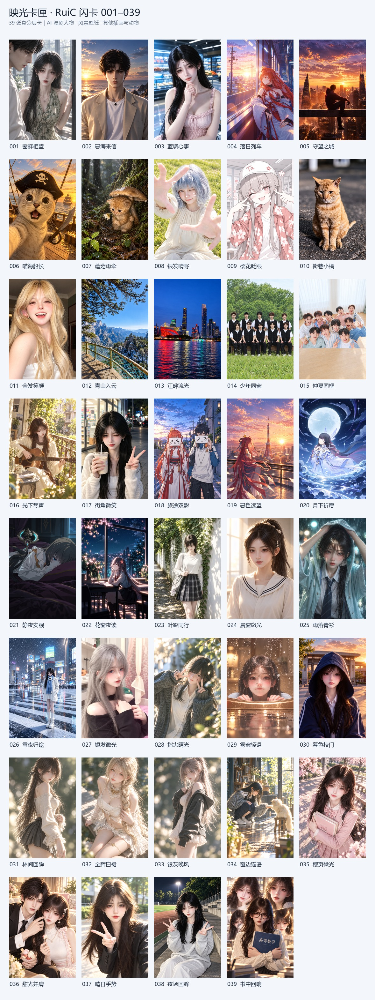

# 映光卡匣 · RuiC Card Library

**离线收藏、浏览与调校真实分层的 3D 闪卡。** 项目包含 Android 应用、Three.js 卡面预览器、39 张 .ruic 闪卡和卡片目录。

> 人物主题包含用户整理的 AI 漫剧女主（如夏柠柒、兰呦呦），也有风景壁纸、动物和其他插画。目录只列主题，不把角色名未经核对地对应到某个卡号。

## 卡片效果演示

单张 038「夜场回眸」的实际 WebGL 卡面：斜视角下可见柔和彩虹镭射与错位的背景、主体层。

## 闪卡目录

当前共 **39 张**：

- **001–008：** 应用内置卡
- **009–039：** 可导入卡
- 查看完整 SKU、名称和格式：[闪卡目录](flashcards/catalog-001-039.json)
- 预览全部卡片：

## 下载

打开 [Releases](https://github.com/suliu496-glitch/ruic-card-library/releases) 获取：

- Android 安装包：RuiC-Card-Library-1.0.4.apk
- 完整闪卡合集：RuiC-Cards-001-039-20261031.zip

合集包含 39 个 .ruic 单卡文件及目录和校验清单。Android 应用内置 001–008；导入合集时若已有同卡，应用会把它作为新导入卡保存。

## 功能

- 本机离线保存卡片、收藏、排序和个人调校参数
- 相册式卡库网格，点选后全屏预览
- 展开真实的背景、主体、线稿和文字层，拖动查看视差
- 珠光、银箔和烫金材质；光泽随观察角度变化
- 在设置中调整拖动旋转灵敏度；在预览中调整层间距、景深和光泽
- 快速扫描 Android 下载目录；支持 .ruic、单卡 ZIP 和闪卡合集 ZIP
- 导入前临时预览；支持从系统文件管理器打开闪卡文件
- 横竖屏和分屏自适应

面向 Android 8.0（API 26）及以上；横屏平板布局以 13.3 英寸大屏为重点。APK 不含按 CPU 架构区分的原生库。3D 效果使用 Three.js / WebGL。

## 构建 Android 应用

需要 JDK 17、Android SDK 35。项目使用 Gradle 9.1.0 和 Android Gradle Plugin 8.11.1。进入 android/ 后：

~~~powershell
.\gradlew.bat :app:assembleDebug :app:lintDebug
~~~

发布版签名配置通过环境变量 RUIC_SIGNING_PROPERTIES 指向本地文件；不要把签名密钥加入 Git。更多构建、导入和存储说明见 [Android 项目说明](android/README.md)。

## 目录

- android/：原生 Android 容器、WebView、安全存储与下载扫描
- web/：卡库界面及交互式 Three.js 卡片预览器
- cards/：应用内置卡片运行资源
- flashcards/：001–039 SKU 目录和导入说明
- previews/：卡片总览、应用渲染效果图与视角动画
- scripts/：卡片预览图生成等维护脚本

## 许可

应用源代码采用 [MIT License](LICENSE)。图片、卡片图稿、角色及其素材不由代码许可证授权；适用说明见 [ARTWORK-NOTICE.md](ARTWORK-NOTICE.md)。开源代码不代表对第三方素材或角色的官方授权、认可或关联声明。

